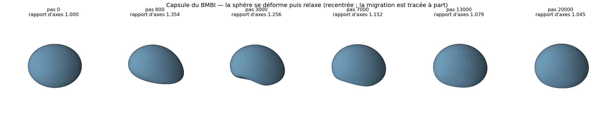
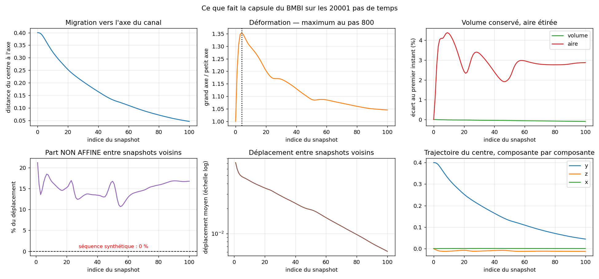

# Les vraies données du BMBI — carte d'identité, et ce qu'elles changent

Journal de la campagne « capsules réelles ». Étape 11 de `PLAN.md`, débloquée le
26/08/2026 par le mail de F. De Vuyst (`Encadrement/`).

Reproduire : `python main_capsules.py` (environ 2 minutes, aucun apprentissage).

Les données sont **propriété du BMBI et confidentielles**. Elles vivent dans
`Données/`, exclu de git. Rien de ce qui suit ne peut être reproduit sans elles.

---

## 1. La question

Le projet a été construit pendant deux mois **contre** ces données sans les
avoir : format d'échange imité, protocole temporel calqué sur ce que rend un
code Éléments Finis, métriques choisies pour ne dépendre d'aucune formule. La
première question n'est donc pas « est-ce que ça marche » mais :

> Ce qu'on a supposé sur les vraies données était-il vrai ?

Ce document répond à ça, et à rien d'autre. Aucun réseau n'est entraîné ici.

## 2. Ce que contient le dataset

Une **capsule unique** dans un canal, simulée par Éléments Finis.

```
connect.npy               (5120, 3)          triangles
off_centered_capsule.npy  (20001, 2562, 3)   x,y,z de chaque nœud, par pas
```

Le maillage est une icosphère de subdivision 4. La connectivité ne change
jamais : les 2562 nœuds sont des **points matériels** suivis dans le temps —
information que notre protocole synthétique s'était volontairement interdite (on
tirait chaque instant avec une graine différente, cas défavorable).

## 3. Le maillage passe-t-il dans notre chaîne ? Oui, sans retouche

| mesure | valeur | conséquence |
|---|---|---|
| `V` / `E` / `F` | 2562 / 7680 / 5120 | |
| `χ = V − E + F` | **2** | genre 0, comme tout ce qu'on a validé |
| étanchéité | **vraie** | chaque arête appartient à exactement 2 triangles |
| volume signé au pas 0 | **+0.522467** | les normales **sortent** déjà |
| aire au pas 0 | 3.137838 | |

Le volume signé positif est le test d'orientation de `src/cloud_io.py`, et il
passe du premier coup : `orient_outward` n'a rien à retourner. Le maillage entre
tel quel dans le format d'échange du projet.

C'est le premier résultat, et il n'était pas acquis : deux des quatre surfaces
exigées par la fiche d'enregistrement (gyroïde, Barth) ne sont pas fermées, et
notre pipeline suppose partout un intérieur borné. Les capsules, elles, sont
exactement dans le cas que le pipeline sait traiter.

## 4. Que fait la capsule

Une **sphère parfaite** au premier pas (rapport d'axes 1.0000, demi-axes égaux à
0.28868). Elle est lâchée **décentrée** dans le canal, à 0.400 de l'axe.

| | |
|---|---|
| **migration** | le centre passe de 0.400 à 0.046 : elle rejoint l'axe |
| **déformation** | rapport d'axes 1.000 → **1.354 au pas 800** → relaxation à 1.045 |
| **volume** | 0.522194, dispersion **0.0256 %**, dérive totale −0.0957 % |
| **aire** | 3.13784 → 3.27543, soit **4.26 % d'étirement** |

Volume constant et aire qui varie : la membrane est **incompressible et
extensible**. C'est exactement la structure d'invariant qu'on avait sur la
séquence synthétique — le volume n'entre nulle part dans la perte, donc il
restera un juge gratuit du champ appris.





## 5. Le résultat qui change le projet : la déformation n'est pas affine

C'était **la limite n°1** de `RESULTATS_temporel.md` :

> « La déformation est affine, monotone, axisymétrique, sans bruit, à topologie
> constante — le contrôle 5.3 montre que c'est trop facile. Par ordre d'utilité :
> (1) déformation NON AFFINE, qui casse l'étalon morphing et rendrait le test
> d'interpolation discriminant. »

On n'a pas eu à la fabriquer. Elle est dans les données.

**Mesure.** Meilleure application affine au sens des moindres carrés entre deux
instants, puis résidu rapporté au déplacement :

| | part non affine |
|---|---|
| séquence synthétique (`src/temporal.py`) | **0 %** par construction |
| capsule, par rapport au premier instant | 2.8 à 21.2 % |
| capsule, **entre deux snapshots voisins** | **14.9 %** en moyenne (10.7 à 21.2) |

C'est la dernière ligne qui compte : c'est ce que voit l'étalon « morphing entre
les deux instants encadrants », celui qui faisait jeu égal avec notre réseau 4D.
Il n'a plus 0 % d'avance structurelle, il a 15 % d'erreur incompressible.

**Et il y a mieux qu'un pourcentage — une preuve.** L'image affine d'un convexe
est convexe. La capsule part d'une sphère, donc d'un convexe. Si elle cesse
d'être convexe, **aucune** application affine ne peut l'y amener.

Défaut de convexité, mesuré par `(volume de l'enveloppe convexe / volume) − 1` :

| pas | 0 | 800 | 1500 | 3000 | 8000 | 20000 |
|---|---|---|---|---|---|---|
| défaut | 0.00 % | 0.00 % | **1.06 %** | **1.51 %** | **1.15 %** | **1.61 %** |

Dès le pas 1500 la capsule est franchement concave — un creux du côté de l'axe
du canal, la forme dite « en parachute », bien visible sur la figure au pas 3000.
CQFD : la déformation est **prouvée** non affine, pas seulement mesurée telle.

## 6. Le résultat qu'on n'attendait pas : le tank-treading

On compare, entre deux instants, le déplacement d'un nœud (mouvement
**matériel**) à sa distance à la surface de départ (mouvement **normal**).
L'écart entre les deux est du glissement **tangentiel**, invisible pour une
surface implicite.

Précaution de mesure : l'écart de temps doit être assez grand pour que le
déplacement dépasse plusieurs arêtes de maillage, sinon le plus proche voisin est
le nœud lui-même et la mesure sature — le même piège que la saturation du Chamfer
documentée dans `RESULTATS_temporel.md`.

| | déplacement matériel | dont normal | **tangentiel** |
|---|---|---|---|
| pas 1000 → 2000 | 0.22386 (5.9 arêtes) | 0.01933 | **91.4 %** |
| pas 5000 → 7000 | 0.27873 (7.4 arêtes) | 0.01794 | **93.6 %** |
| pas 10000 → 14000 | 0.30121 (8.0 arêtes) | 0.01730 | **94.3 %** |
| pas 15000 → 20000 | 0.20054 (5.3 arêtes) | 0.01504 | **92.5 %** |

**93 % du mouvement est du glissement le long de la surface.** La membrane tourne
autour d'une forme qui, elle, bouge peu. C'est le régime de tank-treading, connu
pour les capsules et les globules rouges.

### Ce que ça implique pour nous, et c'est important

**Un contrôle de `RESULTATS_temporel.md` ne se transpose pas.** Le bloc 4 y
advectait un point par la vitesse normale `v_n = −(∂f/∂t)/‖∇_x f‖` et comparait
sa trajectoire à celle du point matériel. Sur la séquence synthétique les deux
coïncidaient. Ici elles ne peuvent pas : elles diffèrent de 93 % du déplacement.

Ce n'est **pas** un défaut du champ implicite. Une surface ne porte que son
mouvement normal — le glissement tangentiel ne la déplace pas, par définition. La
vitesse matérielle n'est pas récupérable depuis `f` seul, et n'a pas à l'être.

Donc : sur ces données, on valide `v_n` contre la vitesse normale exacte du
maillage (projetée), **jamais** contre la trajectoire d'un nœud. Il faut réécrire
ce contrôle avant de le relancer.

Réciproquement, c'est un argument pour la représentation implicite. Un maillage
lagrangien confond les deux mouvements : ses nœuds parcourent 8 arêtes pendant
que la forme bouge de 0.017. Une surface implicite les sépare d'office.

## 7. À quelle fréquence échantillonner le temps

C'est la question pratique que le mail pose (« vous pouvez largement
sous-échantillonner, par exemple 100 snapshots »), et on peut y répondre
quantitativement. Arête moyenne du maillage : 0.03773.

| 1 instant tous les | déplacement moyen | en arêtes |
|---|---|---|
| 10 pas | 0.00097 | 0.03 |
| 50 pas | 0.00482 | 0.13 |
| 100 pas | 0.00963 | 0.26 |
| **200 pas** (= 101 snapshots) | 0.01918 | **0.51** |
| 400 pas | 0.03803 | 1.01 |

101 snapshots uniformes, c'est une demi-arête entre voisins : c'est fin, la
recommandation de Florian est bonne.

**Mais un échantillonnage uniforme est mal dépensé.** La déformation culmine au
pas 800, soit au 4ᵉ snapshot sur 101, et tout le reste est une relaxation lente :
le déplacement entre snapshots voisins passe de 0.0715 à 0.0061, un facteur 12,
et la moitié des instants ont un rapport d'axes sous 1.088 alors que le maximum
est 1.354.

D'où `capsules.instants_transitoire`, qui resserre le début en `t ∝ (k/n)²`.
Pour une première campagne, c'est le bon échantillonnage : il met les instants là
où il se passe quelque chose.

## 8. Ce qu'on retient

1. **Le maillage entre dans la chaîne sans retouche** — fermé, manifold, orienté,
   genre 0. Deux mois de travail « à l'aveugle » sur le bon format.
2. **La déformation est non affine, et prouvée telle** par la perte de convexité.
   La limite n°1 du projet tombe : le test d'interpolation devient discriminant,
   et l'étalon morphing part avec 15 % d'erreur.
3. **Le volume est conservé à 0.0256 %** : l'invariant gratuit est là aussi.
4. **93 % du mouvement est tangentiel.** Un contrôle du projet doit être réécrit,
   et c'est en même temps un argument pour la représentation implicite.
5. **La capsule migre** : le champ doit soit encaisser la translation, soit la
   séparer. On la sépare (`recentre=True`), la trajectoire du centre étant une
   fonction du temps à trois composantes, triviale à ajuster à part.
6. **101 snapshots uniformes = 0.51 arête entre voisins**, c'est assez fin ; mais
   resserrer le début est mieux dépensé.

## 9. Ce que ça ne dit pas

- **Une seule capsule, un seul régime.** Pas de fusion, pas de changement de
  topologie, pas de bruit de mesure. Le stress-test topologique du projet
  (metaballs) reste synthétique.
- **Aucun apprentissage n'a encore été fait sur ces données.** Tout ce document
  décrit la donnée, pas notre méthode appliquée à elle.
- **Le maillage n'est pas la vérité terrain absolue** : c'est déjà une
  discrétisation. Le volume de l'icosphère de départ vaut 0.522467 contre
  0.523599 pour la sphère exacte de rayon 0.5, soit 0.22 % de moins — c'est le
  facettage. Toute erreur de reconstruction sous ce seuil n'est pas mesurable.

## 10. Ce qui a été ajouté

| fichier | rôle |
|---|---|
| `src/capsules.py` | chargement `mmap`, recentrage, normales par triangle, export au format du projet, mesures (`part_non_affine`, `demi_axes`, `geometrie`) |
| `main_capsules.py` | les six blocs ci-dessus, les figures, l'export des 101 instants |
| `Données/README.md` | contenu du dataset, confidentialité, mode d'emploi |
| `Encadrement/mail_2026-08-26_dataset-capsules.md` | le mail, et la clause à renvoyer |
