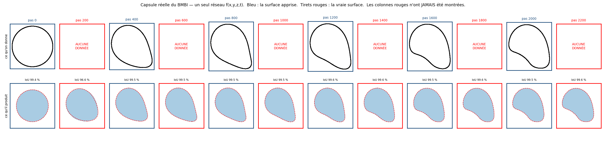
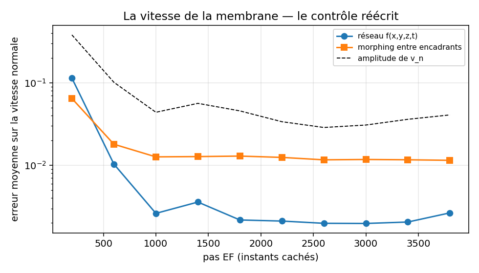
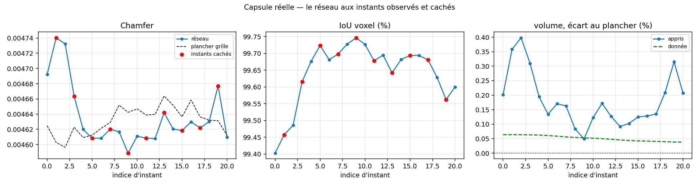
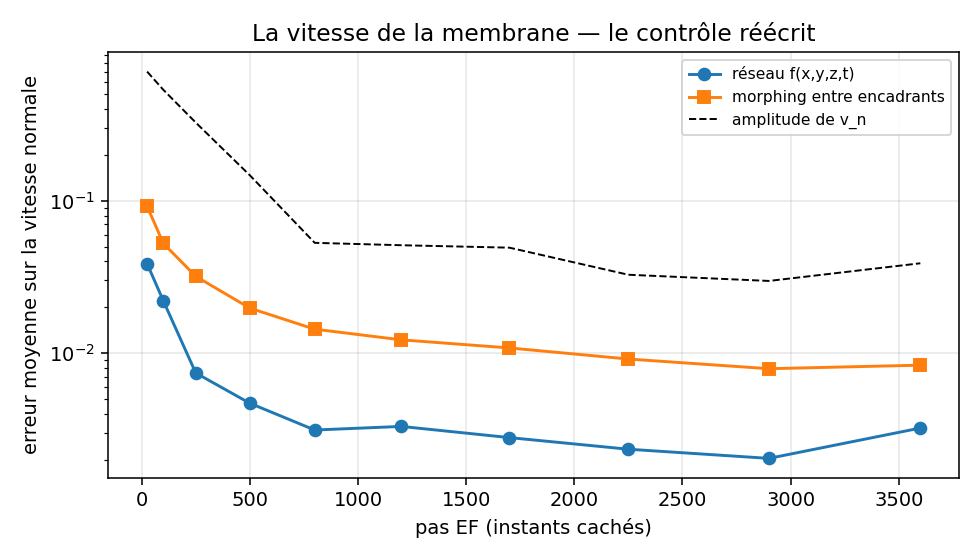

# La surface espace-temps, sur la vraie capsule du BMBI

Journal de la campagne de l'étape 14 : `f(x,y,z,t)` appris sur les données
réelles, et non plus sur une séquence qu'on avait fabriquée.

Reproduire : `python main_capsules_temporal.py uniforme` puis
`python main_capsules_temporal.py transitoire` (4 à 5 minutes chacun sur un M2).
Les données du BMBI sont confidentielles et hors git : sans elles, rien de ceci
n'est reproductible.

---

## 1. La question, et pourquoi elle se pose autrement qu'avant

`RESULTATS_temporel.md` avait montré qu'un seul réseau `f(x,y,z,t)` pouvait
condenser une séquence et reconstruire des instants jamais vus. Mais ce document
se terminait sur un aveu :

> « Sur la POSITION de la surface, le réseau 4D fait jeu égal avec un simple
> morphing entre les deux instants encadrants. Notre déformation est affine, donc
> trop favorable à cet étalon. »

La question de cette campagne est donc précise :

> Sur une déformation **réelle**, non affine, le champ espace-temps bat-il enfin
> les méthodes bêtes — et de combien ?

## 2. Le protocole

Fenêtre sur le **transitoire** (pas EF 0 à 4000), là où la capsule se déforme
vraiment : elle part d'une sphère parfaite, s'aplatit jusqu'à un rapport d'axes
de 1.354 au pas 800, puis relaxe (voir `RESULTATS_capsules.md`).

**21 instants, un sur deux caché.** 11 observés écrits sur disque au format
d'échange du projet, 10 cachés dont le réseau ne reçoit rien.

Et **deux échantillonnages**, parce que le premier a révélé le second :

| mode | instants observés |
|---|---|
| `uniforme` | 0, 400, 800, …, 4000 — un tous les 400 pas |
| `transitoire` | 0, 50, 150, 350, 650, 1000, 1450, 1950, 2550, 3250, 4000 |

Le mode `uniforme` applique la recommandation du mail (« par exemple 100
snapshots ») à notre fenêtre. Le mode `transitoire` garde le **même nombre**
d'instants mais les resserre au début, en `t ∝ (k/n)²`.

**Rien d'autre ne change entre les deux** : même réseau (`TemporalIGRNet`,
197 885 poids), même perte, mêmes 8000 époques, même grille 96³, même graine.

### Ce qui a dû être construit parce qu'il n'y a plus de formule

Sur la séquence synthétique, la vérité était analytique. Ici il faut la fabriquer
à partir du **maillage seul** — et prouver qu'on peut s'y fier.

`capsules.champ_reference` : distance au plus proche point d'un nuage de 60 000
points tirés sur les triangles, signe par produit scalaire avec la normale de ce
point. C'est la règle du mail de F. De Vuyst, appliquée à la lettre.

**Validation** : le signe de ce champ a été confronté au test d'appartenance
exact de `trimesh` sur 20 000 points tirés dans la boîte. **100.000 % d'accord.**
On s'autorise donc à s'en servir comme juge.

Ce champ de référence sert à trois choses : le **plancher** du Chamfer (marching
cubes appliqué dessus), l'**occupation** de référence pour l'IoU voxel et le
volume, et les **étalons** (image gelée, morphing), qui s'interpolent sur la même
grille.

## 3. Le plancher, d'abord

Marching cubes sur le champ de référence, grille 96³ : **Chamfer 0.00463**.

C'est l'erreur de discrétisation pure. Aucun champ appris ne peut descendre en
dessous. Sans ce repère on attribuerait au réseau une erreur qui n'appartient
qu'à la grille — la leçon de saturation déjà tirée dans `RESULTATS_temporel.md`,
appliquée d'emblée.

## 4. Résultat — échantillonnage uniforme

| | instants observés | **instants jamais vus** | plancher |
|---|---:|---:|---:|
| Chamfer | 0.00467 | **0.00500** | 0.00463 |
| IoU voxel | 99.530 % | **99.251 %** | 100 % |
| χ | 2 | **2** | 2 |

Aux dix instants cachés, contre les étalons :

| méthode | Chamfer | **excédent sur le plancher** | IoU |
|---|---:|---:|---:|
| image gelée (instant observé le plus proche) | 0.00799 | 0.00335 | 97.07 % |
| morphing entre les deux encadrants | 0.00533 | 0.00070 | 98.85 % |
| **réseau `f(x,y,z,t)`** | **0.00500** | **0.00036** | **99.25 %** |
| plancher de la grille | 0.00464 | 0 | 100 % |

**Le réseau bat le morphing.** C'est le résultat que la séquence synthétique
n'avait pas pu produire : là-bas 0.00815 contre 0.00806, le morphing gagnait d'un
cheveu ; ici le réseau est devant, et en excédent sur le plancher — la seule
lecture honnête d'une métrique saturée — il est **1.9 fois** meilleur.

## 5. La vitesse de la membrane — le contrôle réécrit

93 % du mouvement des nœuds est **tangentiel** (`RESULTATS_capsules.md`). Le
contrôle lagrangien du travail synthétique, qui advectait un point par `v_n` et
le comparait à la trajectoire d'un nœud, n'a donc **aucun sens ici**. On compare
`v_n` appris à `v_n` du **maillage** : la vitesse des nœuds projetée sur la
normale, qui est bien la vitesse de la surface, et la seule chose qu'un champ
implicite ait à porter.

### D'abord : peut-on croire la référence ?

`v_n` du maillage est une différence centrée, donc dépend de son écart. On l'a
fait converger avant de s'en servir :

| pas | écart 25 | 50 | 100 | 200 |
|---|---:|---:|---:|---:|
| 200 | 0.0 % | 0.5 % | 2.6 % | **10.5 %** |
| 2200 | 0.0 % | 0.3 % | 1.5 % | 6.3 % |
| 3800 | 0.0 % | 0.2 % | 0.8 % | 3.3 % |

**La première version de cette campagne mesurait avec un écart de 200 pas.** La
référence était donc fausse de 3 à 12 %, et l'erreur du réseau était mesurée
contre elle. On a repris avec un écart de 25 pas, où elle est stationnaire.
Mesurer la vitesse d'un champ appris contre une référence fausse de 10 % n'aurait
rien dit.

### Le résultat, et pourquoi la moyenne ment

| pas caché | amplitude de `v_n` | réseau | morphing | gain |
|---:|---:|---:|---:|---:|
| **200** | **0.38055** | **0.11390** | **0.06461** | **0.6× — il PERD** |
| 600 | 0.10142 | 0.01034 | 0.01800 | 1.7× |
| 1000 | 0.04393 | 0.00261 | 0.01265 | 4.8× |
| 1400 | 0.05636 | 0.00363 | 0.01275 | 3.5× |
| 1800 | 0.04564 | 0.00228 | 0.01293 | 5.7× |
| 2200 | 0.03376 | 0.00217 | 0.01246 | 5.8× |
| 2600 | 0.02873 | 0.00190 | 0.01165 | 6.1× |
| 3000 | 0.03076 | 0.00195 | 0.01176 | 6.0× |
| 3400 | 0.03609 | 0.00192 | 0.01166 | 6.1× |
| 3800 | 0.04079 | 0.00200 | 0.01149 | 5.7× |

En moyenne, le réseau n'est que **1.3 fois** meilleur. Mais la moyenne est
écrasée par un seul instant : au pas 200, l'amplitude de `v_n` vaut 8 fois celle
du reste de la séquence, et le réseau **perd**. Sur les neuf autres instants, il
est **3.9 fois** meilleur, et le gain monte régulièrement jusqu'à 6×.

**Diagnostic.** La sphère se déforme presque tout entière dans les 800 premiers
pas. Un instant observé tous les 400 pas y est trop grossier : le réseau n'a que
deux photos pour couvrir la partie la plus violente du mouvement. Ce n'est pas
une limite de la méthode, c'est une limite de **l'échantillonnage**.

Et c'est exactement la question pratique posée au BMBI : *à quelle fréquence leur
code Éléments Finis doit-il sauvegarder ?* On peut maintenant y répondre — et la
vérifier.

## 6. Résultat — échantillonnage resserré au début

Même nombre d'instants, même réseau, même perte, même graine. Seule change la
**place** des onze instants observés.

| | instants observés | **instants jamais vus** | plancher |
|---|---:|---:|---:|
| Chamfer | 0.004634 | **0.004639** | 0.004631 |
| IoU voxel | 99.636 % | **99.650 %** | 100 % |
| χ | 2 | **2** | 2 |

**Aux instants qu'il n'a jamais vus, le réseau est au plancher de la grille.**
Excédent : `7.4·10⁻⁶`, soit **0.16 %** du plancher. Et l'IoU aux instants cachés
est très légèrement *meilleure* qu'aux instants observés — les deux sont
indiscernables, ce qui est précisément le résultat recherché.

| méthode | Chamfer | excédent sur le plancher | en % du plancher | IoU |
|---|---:|---:|---:|---:|
| image gelée | 0.00710 | 0.00247 | 53 % | 97.28 % |
| morphing entre encadrants | 0.00487 | 0.00024 | 5.2 % | 99.17 % |
| **réseau `f(x,y,z,t)`** | **0.00464** | **0.0000074** | **0.16 %** | **99.65 %** |

*Précaution de lecture* : le rapport des excédents vaut 33, mais c'est un rapport
de deux très petits nombres, donc fragile. La formulation robuste est celle de la
colonne de droite : **le réseau est à 0.16 % du plancher, le morphing à 5.2 %.**

*Et le « plancher » n'est pas une borne stricte.* Instant par instant, le Chamfer
du réseau passe parfois SOUS celui du champ de référence — de quelques unités de
la cinquième décimale (0.00459 à 0.00474 pour l'un comme pour l'autre). C'est
normal : les deux sont des maillages de marching cubes comparés à un nuage
échantillonné, et rien n'impose que celui issu de la référence soit le plus
proche à chaque instant. La bonne conclusion n'est donc pas « le réseau atteint
le plancher » au sens d'une borne franchie, mais **« le réseau et le plancher
sont indiscernables au bruit de grille près »** — ce qui est exactement ce qu'on
cherchait à établir, et c'est visible sur la figure des diagnostics, où les
instants cachés (points rouges) sont noyés parmi les observés.

Sur la vitesse normale :

| | amplitude | réseau | morphing |
|---|---:|---:|---:|
| moyenne sur les 10 instants cachés | 0.19690 | **0.00896** (4.6 %) | 0.02591 (13.2 %) |

Le réseau passe de 18 % d'erreur relative (uniforme) à **4.6 %**, et il ne perd
plus sur aucun instant.

## 7. Le volume — l'invariant que la perte ignore

Le volume n'apparaît nulle part dans l'entraînement. C'est donc un juge gratuit.

| | volume moyen | dispersion |
|---|---:|---:|
| donnée (maillage) | 0.52240 | 0.0091 % |
| plancher (marching cubes sur la référence) | 0.52214 | 0.0124 % |
| **champ appris (transitoire)** | **0.52308** | **0.0907 %** |

Le biais du champ appris sur le plancher est de **+0.18 %** — la surface apprise
est très légèrement plus grosse que la vraie.

**Ce chiffre-là, il ne faut pas le sur-interpréter.** Trois exécutions du mode
`uniforme`, à configuration et graine identiques, ont donné une dispersion de
volume de 0.055 %, 0.221 % et 0.462 %. Le Chamfer, lui, est resté à 0.00500 aux
trois. C'est la non-reproductibilité sur GPU Apple déjà documentée dans
`PLAN.md` : seul l'ordre de grandeur du volume est interprétable, pas sa
troisième décimale.

## 8. Ce qu'on retient

1. **Sur une déformation réelle, le champ espace-temps bat le morphing.** Ce que
   la séquence synthétique ne pouvait pas montrer, faute d'être assez difficile.
2. **Avec le bon échantillonnage, il atteint le plancher de la grille aux
   instants qu'il n'a jamais vus** — 0.16 % au-dessus, contre 5.2 % pour le
   morphing. Observés et cachés sont indiscernables.
3. **Le placement des instants compte plus que leur nombre.** À nombre égal, les
   resserrer là où la forme bouge fait passer l'erreur de vitesse de 18 % à 4.6 %
   et l'excédent de Chamfer d'un facteur 50. C'est une réponse chiffrée à la
   question du BMBI : *sauvegarder proportionnellement à la vitesse de
   déformation, pas à intervalle constant.*
4. **Le contrôle de vitesse a dû être réécrit deux fois** — une fois pour le
   tank-treading (on ne suit pas des trajectoires), une fois pour la convergence
   de la référence (une différence centrée trop large fausse tout de 10 %). Les
   deux erreurs auraient produit des chiffres d'allure crédible.

## 9. Ce que ça ne prouve pas

- **Une seule capsule, un seul régime, une seule fenêtre.** Rien n'est dit d'une
  autre capsule, d'un autre nombre de Reynolds, ni de la fin de la séquence
  (pas 4000 à 20000), qui est une relaxation lente et donc plus facile.
- **Le réseau n'extrapole pas, il interpole.** Tous les instants cachés sont
  encadrés par des instants observés. On n'a rien testé au-delà du dernier.
- **La topologie ne change jamais** (χ = 2 partout, dans la donnée comme dans la
  reconstruction). Le cas de deux capsules qui fusionnent reste synthétique.
- **La déformation reste sans bruit** : c'est une simulation, pas une mesure.
- **Le gain de 33× en excédent de Chamfer est fragile** — voir la précaution de
  lecture au §6.
- **Aucune moyenne sur plusieurs graines.** Les écarts entre modes sont grands
  devant la variabilité observée sur le Chamfer, mais pas devant celle du volume.

## 10. Ce qui a été ajouté

| fichier | rôle |
|---|---|
| `main_capsules_temporal.py` | la campagne, dans ses deux modes d'échantillonnage |
| `src/capsules.py` | `champ_reference`, `echantillon_surface`, `vitesse_normale_maillage` |
| `figures/capsules_temporel_*` | les figures des deux modes |
| `output/capsules_temporel_*_resume.json` | tous les chiffres, pour être relus sans réentraîner |
