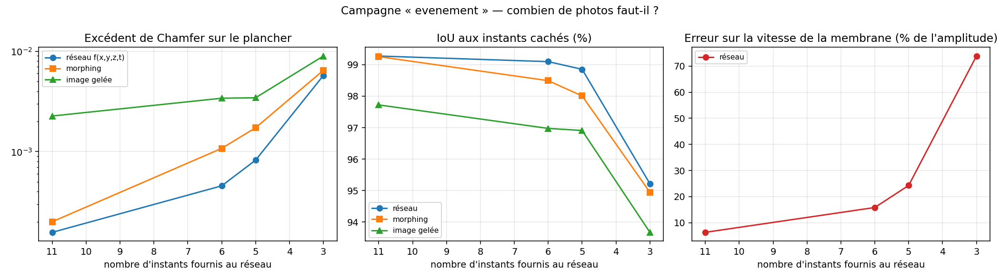
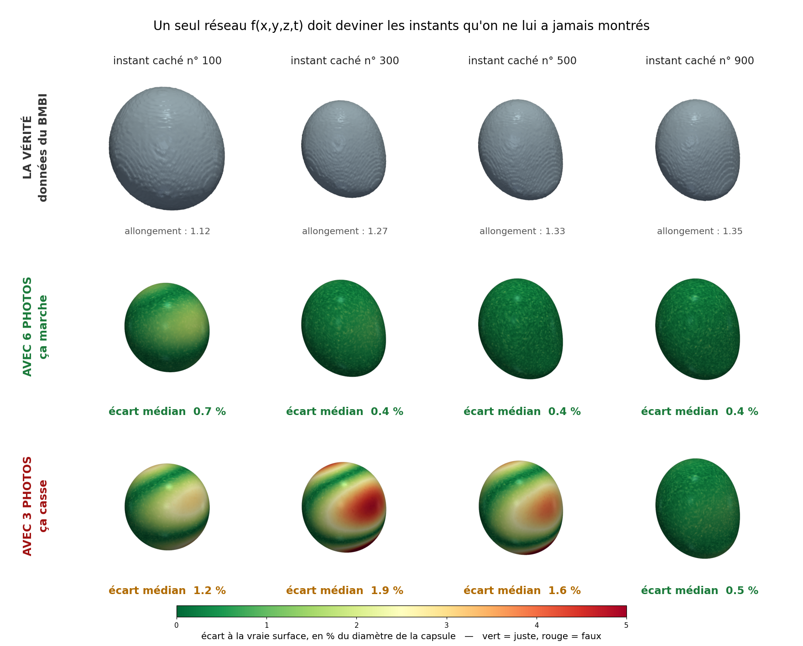
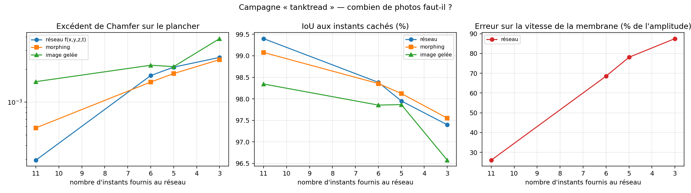

# Combien d'instants faut-il ? Les deux régimes de la capsule

Journal des deux campagnes de compression temporelle. C'est la question pratique
que pose le BMBI — *à quelle fréquence le code Éléments Finis doit-il
sauvegarder ?* — et c'est la seule qui avait encore de la marge : dès qu'on donne
assez d'instants, la reconstruction est au plancher de la grille et plus rien ne
départage les méthodes (`RESULTATS_capsules_temporel.md`).

Reproduire : `python main_capsules_event.py` puis `python main_capsules_tanktread.py`
(environ 18 minutes chacun sur un M2). Données du BMBI confidentielles, hors git.

---

## 1. Le protocole, identique pour les deux régimes

Les deux campagnes ne valent que si elles suivent exactement le même protocole.
Le seul moyen d'en être sûr est qu'elles exécutent le **même code** :
`src/campagne.py` porte toute la mécanique, et les deux scripts ne sont que la
fenêtre de pas de temps. Rien d'autre ne peut diverger par accident.

- **21 instants d'évaluation** équirépartis dans la fenêtre. Toutes les
  configurations sont jugées sur eux, et sur eux seuls.
- **Une configuration = un nombre d'instants observés**, pris dans cette grille.
  Les autres sont cachés : le réseau n'en reçoit rien.
- **La vérité vient du maillage seul** (`capsules.champ_reference`, validée à
  100 % contre le test d'appartenance exact de trimesh). Elle donne aussi le
  **plancher** : marching cubes appliqué dessus, c'est-à-dire l'erreur de
  discrétisation pure.
- **Deux étalons** aux mêmes instants cachés : l'image gelée (rendre l'instant
  observé le plus proche) et le morphing entre les deux encadrants.
- **La vitesse normale** est comparée à celle du maillage, par différence centrée
  étroite — jamais à une trajectoire de nœud, puisque 93 % du mouvement est
  tangentiel.

Réseau, perte, époques, graine, grille de reconstruction : identiques partout.

### Les deux fenêtres

| | événement | tank-treading |
|---|---|---|
| pas EF | 0 → 2000 | 4000 → 20000 |
| ce qui s'y passe | la sphère s'écrase, se creuse | la forme relaxe lentement, la matière tourne |
| rapport d'axes | 1.000 → 1.354 → 1.296 | 1.203 → 1.045 |
| instant d'évaluation tous les | 100 pas | 800 pas |
| déplacement entre eux | 0.57 à 1.01 arête | 0.66 à 3.54 arêtes |
| plancher de la grille 96³ | 0.00464 | 0.00455 |

Noter que la fenêtre tank-treading n'est **pas** la plus facile : elle est huit
fois plus longue, et le déplacement entre deux instants d'évaluation y monte à
3.5 arêtes contre 1.0 dans l'événement.

## 2. Régime « événement » — la déformation rapide

| observés | cachés | Chamfer | excédent sur le plancher | × morphing | IoU | erreur sur `v_n` | topologie |
|---:|---:|---:|---:|---:|---:|---:|:---:|
| 11 | 10 | 0.00480 | 0.00016 | 1.3× | 99.28 % | **6.3 %** | χ = 2 |
| **6** | 15 | 0.00509 | 0.00046 | **2.4×** | 99.10 % | 15.8 % | χ = 2 |
| 5 | 16 | 0.00546 | 0.00082 | 2.1× | 98.85 % | 24.3 % | χ = 2 |
| 3 | 18 | 0.01038 | 0.00574 | 1.1× | 95.22 % | **73.8 %** | χ = 2 |

*Les surfaces prédites sont colorées par leur écart à la vraie surface, au point
le plus proche d'un nuage dense tiré sur le maillage. Les douze vues partagent la
même caméra et la même échelle : une différence visible est une différence de
forme. Noter que l'échec à 3 instants n'est pas uniforme — il se concentre en
bandes, là où la surface doit se déplacer le plus entre deux photos, et il
s'efface près des instants observés (pas 900 est proche du pas 1000, qui est
fourni).*

**Ça casse entre 5 et 3.** À 3 instants, l'erreur sur la vitesse de la membrane
atteint 74 % de son amplitude : le champ ne dit plus rien d'exploitable sur le
mouvement, et l'avantage sur le morphing s'effondre à 1.1×.

**L'avantage du réseau est maximal au milieu**, pas aux extrêmes. À 11 instants
tout le monde est au plancher et il n'y a rien à départager ; à 3 instants
personne n'y arrive. C'est entre les deux que la différence se voit : à 6
instants, le réseau ajoute 2.4 fois moins d'erreur que l'interpolation.

**La topologie tient partout**, même à 3 instants. C'est un point non trivial :
la reconstruction reste une sphère fermée alors que la géométrie est fausse.

## 3. Régime « tank-treading » — et une prédiction démentie

On attendait beaucoup de ce régime. L'argument était : 93 % du mouvement des
nœuds est tangentiel, donc une séquence de maillages dépense l'essentiel de son
information à décrire du glissement qui ne déplace pas la surface, alors qu'un
champ implicite ne porte que la forme. On s'attendait donc à ce que **très peu**
d'instants suffisent.

| observés | cachés | Chamfer | excédent sur le plancher | × morphing | IoU | erreur sur `v_n` | topologie |
|---:|---:|---:|---:|---:|---:|---:|:---:|
| 11 | 10 | 0.00484 | 0.00029 | **2.0×** | 99.40 % | 26.0 % | χ = 2 |
| 6 | 15 | 0.00630 | 0.00176 | **0.9×** | 98.38 % | 68.5 % | χ = 2 |
| 5 | 16 | 0.00664 | 0.00210 | **0.9×** | 97.95 % | 78.1 % | χ = 2 |
| 3 | 18 | 0.00712 | 0.00258 | 1.0× | 97.40 % | 87.5 % | χ = 2 |

**La prédiction était fausse.** En dessous de 11 instants, le réseau ne bat plus
le morphing — il fait jeu égal, et à 6 et 5 instants il est légèrement **derrière**.

L'explication est simple une fois qu'on la voit : dans ce régime la forme dérive
**lentement et presque linéairement**. C'est précisément le cas où une
interpolation linéaire entre deux formes voisines est quasi exacte. Le champ
neuronal n'y a aucun avantage structurel à exploiter — c'est le même mécanisme
qui, sur la séquence synthétique affine de `RESULTATS_temporel.md`, faisait déjà
jeu égal entre les deux.

Autrement dit : **le tank-treading n'est pas un régime difficile pour la
géométrie**, il est difficile pour le suivi de matière. Or on ne mesure pas le
suivi de matière — et on a établi qu'on ne le peut pas depuis un champ implicite.

## 4. Ce que la comparaison ne teste PAS — un défaut de cadrage à assumer

L'argument « implicite contre maillage lagrangien » **n'est pas mesuré ici**, et
il faut le dire clairement.

L'étalon morphing interpole entre deux **champs de référence**, c'est-à-dire
entre deux formes. Lui non plus ne stocke pas les trajectoires de nœuds. La
comparaison de ce document oppose donc *un champ neuronal* à *une interpolation
linéaire de formes* — ce qui est une question différente, et plus dure, que celle
qu'on croyait poser.

L'argument sur le tank-treading reste vrai par construction (une surface
implicite ne porte pas le glissement tangentiel, un maillage lagrangien si), mais
il est **structurel, pas expérimental** : ce protocole ne peut pas l'établir.
Le mesurer demanderait un troisième étalon — une séquence de maillages
lagrangiens jugée sur sa capacité à restituer la forme, ce qui n'a pas été fait.

## 5. Le réseau n'est pas un compresseur

| | taille |
|---|---:|
| un maillage (2562 nœuds × 3 × float64) | 60 Ko |
| **le champ `f(x,y,z,t)`** (197 885 poids × float32) | **773 Ko** |

| instants fournis | ce qu'ils pèsent | le réseau vaut |
|---:|---:|---|
| 11 | 661 Ko | **1.17×** son entrée |
| 6 | 360 Ko | 2.15× |
| 5 | 300 Ko | 2.57× |
| 3 | 180 Ko | 4.29× |

**Le réseau coûte systématiquement plus cher que les instants qu'on lui donne.**
On lit parfois qu'il représente 938 Mo de séquence complète en 773 Ko, soit
1243× moins — c'est vrai mais trompeur : personne ne stocke les 16 001 pas, et
l'étalon morphing s'en tire avec les mêmes 11 maillages sans aucun poids.

**Ce que le champ achète n'est donc pas de la place, c'est de la continuité** :
une valeur ET une dérivée en tout point de l'espace-temps, un test dedans/dehors,
une normale, une courbure — là où une liste de maillages ne donne que des
positions à des instants discrets. C'est un argument réel, mais ce n'est pas un
argument de compression, et il ne faut pas le présenter comme tel.

## 6. La réponse à la question du BMBI

En prenant comme seuil d'utilisabilité une erreur de vitesse normale **sous
25 %** — au-delà, le champ de vitesse ne sert plus à rien :

| régime | instants nécessaires | soit un instant tous les |
|---|---:|---|
| déformation rapide (pas 0 → 2000) | **5 à 6** | 400 pas |
| relaxation lente (pas 4000 → 20000) | **11 et plus** | 1600 pas |

Rapporté à la vitesse de déformation, c'est cohérent : dans les deux cas il faut
un instant environ **tous les 0.5 à 1.0 déplacement d'arête de maillage**. C'est
la règle pratique, et elle est indépendante du régime :

> **sauvegarder quand la membrane a bougé d'environ une arête de maillage.**

Pour la séquence complète, cela veut dire un échantillonnage **non uniforme** :
resserré au début, relâché ensuite — ce que `RESULTATS_capsules_temporel.md`
avait déjà établi par l'échec de l'échantillonnage uniforme.

## 7. Ce que ces chiffres ne prouvent pas

- **Les ratios à 11 instants ne sont pas fiables.** L'excédent y est si petit
  (0.00016) qu'il est dominé par la variabilité du GPU Apple : deux exécutions de
  la même configuration ont donné 0.00006 et 0.00016, soit un facteur 2.7 sur
  l'excédent alors que le Chamfer ne bougeait que de 2 %. Seules les
  configurations à 6, 5 et 3 instants donnent des rapports interprétables.
- **Une seule graine par configuration.** Rien n'est moyenné.
- **Une seule capsule, un seul écoulement.** Les seuils donnés au §6 valent pour
  cette simulation, pas pour toutes.
- **Le seuil de 25 % sur `v_n` est un choix**, pas une propriété des données. Un
  autre usage justifierait un autre seuil, et donc un autre nombre d'instants.
- **Aucune extrapolation testée** : tous les instants cachés sont encadrés par
  des instants observés.
- **La topologie tient partout, y compris quand la géométrie est fausse** —
  `χ = 2` à 3 instants avec 74 % d'erreur de vitesse. Un invariant topologique
  correct ne garantit donc rien sur la qualité géométrique.

## 8. Ce qu'on retient

1. **Il existe un seuil net**, et il est mesurable : sous 5 instants sur
   l'événement, le champ de vitesse devient inutilisable (74 % d'erreur).
2. **L'avantage du réseau sur l'interpolation est maximal au milieu** — 2.4× à
   6 instants sur l'événement. Aux deux extrêmes, il n'y a rien à départager.
3. **La prédiction sur le tank-treading était fausse** : c'est le régime où
   l'interpolation linéaire marche le mieux, donc celui où le réseau a le moins
   à apporter.
4. **Le réseau n'est pas un compresseur** : il pèse 1.2 à 4.3 fois ses propres
   données d'entrée. Il achète de la continuité, pas de la place.
5. **La règle pratique pour le BMBI** : un instant sauvegardé par déplacement
   d'arête de maillage, donc un échantillonnage non uniforme.
