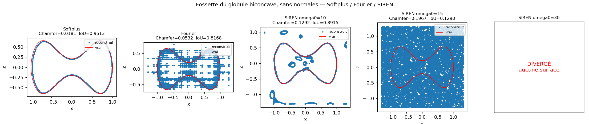

# Rendu, formats d'échange, surfaces complexes et SIREN

Trois chantiers de la fiche d'enregistrement qui n'avaient pas encore été
traités : l'affichage PyVista au format VTK (nommé deux fois), l'exploration
des surfaces complexes (ligne de 3 h), et la troisième architecture de réseau
pour compléter la comparaison.

Scripts : `main_render.py`, `main_shapes.py`, `main_siren.py`.
Modules : `src/viz_pv.py`, `src/shapes_complexes.py`, `src/model_siren.py`.

---

## 1. Rendu PyVista et export

### Pourquoi

Le projet affichait tout en matplotlib. C'est suffisant pour contrôler une
reconstruction du coin de l'œil, mais insuffisant pour deux usages qui
comptent :

- **montrer un champ scalaire sur une surface.** Une courbure est définie point
  par point ; il faut une coloration interpolée aux sommets avec une barre de
  couleur légendée, ce que `Poly3DCollection` ne fait pas proprement.
- **transmettre un maillage.** Une figure PNG ne se remesure pas. Pour donner
  un résultat au labo, il faut un fichier que ParaView, Blender ou un autre
  code sachent relire.

### Ce que fait `src/viz_pv.py`

| fonction | rôle |
|---|---|
| `to_polydata` | convertit la sortie de `marching_cubes` au format PyVista, et attache un champ scalaire aux sommets |
| `prepare` | normales aux sommets (rendu lisse) + lissage laplacien **optionnel** |
| `camera_for` | position de caméra **déterministe**, calculée depuis la boîte englobante |
| `render` | image PNG hors écran, avec barre de couleur et bornes `clim` imposables |
| `render_comparison` | plusieurs maillages côte à côte, **caméras liées** |
| `export_obj` / `export_vtk` | OBJ via trimesh, VTK/VTP via PyVista |
| `export_time_series` | un `.vtp` par instant + l'index `.pvd` que ParaView lit comme une animation |
| `relire` | rouvre un fichier exporté et **recompte** ses sommets |

Deux choix méritent d'être justifiés.

**Le lissage est à zéro par défaut.** `mesh.smooth()` embellit une isosurface
mais il *déplace les sommets*. Une aire, un volume ou une courbure mesurés
après lissage sont faux. On ne l'active donc que pour une figure, jamais avant
une mesure.

**La caméra est explicite, pas `"iso"` + `zoom`.** Le raccourci du notebook
laisse VTK ajuster le cadrage, ce qui dépend des bornes de l'objet : deux
formes de tailles différentes ne sont alors plus comparables. `camera_for`
place la caméra au centre de la boîte englobante plus une direction fixée, à
une distance proportionnelle au rayon de la boîte. Et `render_comparison` lie
les caméras (`link_views`) : **une différence visible entre deux panneaux est
une différence de forme, jamais un effet de cadrage.**

### La figure du globule coloré par sa courbure

Maillage du quartique de Kuchel sur une grille 180³ :

```
maillage     : V=159 488   F=318 972   chi=2   étanche=True
géométrie    : aire = 128.017 µm²      volume = 85.974 µm³
Gauss-Bonnet : ∫K dA = +12.5663   attendu 4π = +12.5664   écart = 0.001 %
courbure     : K_G min = -0.02818   médiane = +0.14475   max = +0.38318 µm⁻²
```

L'article de Kuchel et al. donne 128 µm² et 86 fL : l'écart est de 0.013 % sur
l'aire et 0.030 % sur le volume. Gauss-Bonnet tombe à 0.001 % de 4π — dix fois
mieux que les 0.0247 % de `main_curvature.py`, simplement parce que la grille
est plus fine (180³ contre 96³). Cela confirme au passage que l'écart mesuré
sur le réseau appris venait bien du réseau, pas de l'outil de mesure.

La figure (`figures/pv_globule_courbure.png`) montre trois zones nettes :
K_G **maximale au fond de la fossette**, quasi **nulle sur la crête
d'épaisseur**, et forte sur le bourrelet extérieur. C'est ce que prédit la
formule pour une surface de révolution, `K_G = z'z'' / (r(1+z'²)²)` : au fond
de la fossette `z' = 0` et `z'' > 0` donc K_G est maximale, sur la crête
`z' = 0` et `z'' = 0` donc K_G s'annule.

### Les exports, chacun relu

On ne se fie pas à la taille du fichier : un fichier de 12 Mo peut être vide de
géométrie. Chaque export est rouvert et ses sommets recomptés.

| fichier | taille | sommets relus | faces relues | champs conservés |
|---|---:|---:|---:|---|
| `globule.obj` | 12 198 Ko | 159 488 | 318 972 | — |
| `globule.vtk` | 20 559 Ko | 159 488 | 318 972 | `K_gauss`, `Normals` |
| `globule.vtp` | 11 554 Ko | 159 488 | 318 972 | `K_gauss`, `Normals` |

Les trois retrouvent exactement les 159 488 sommets et 318 972 faces du
maillage de départ. **OBJ perd les champs scalaires** : c'est le format à
donner quand on transmet une géométrie. **VTK et VTP les conservent** : c'est
le format à donner quand on transmet une mesure. C'est le format VTK que nomme
la fiche.

### La série temporelle

Les six instants du champ `f(x,y,z,t)` exportés en `.vtp` plus un index `.pvd` :

| t | ξ | sommets | volume du maillage |
|---|---|---|---|
| 0.0 | 1.000 | 22 656 | 1.34138 |
| 0.2 | 1.100 | 22 656 | 1.34138 |
| 0.4 | 1.200 | 22 656 | 1.34138 |
| 0.6 | 1.300 | 22 656 | 1.34138 |
| 0.8 | 1.400 | 22 656 | 1.34138 |
| 1.0 | 1.500 | 22 656 | 1.34138 |

Le volume est identique à la cinquième décimale aux six instants : la
déformation `diag(ξ^-½, ξ^-½, ξ)` conserve bien le volume, et le maillage
lagrangien le conserve aussi. C'est un contrôle du protocole temporel, obtenu
gratuitement en passant par PyVista.

Le `.pvd` fait 0.6 Ko — ce n'est qu'un index XML. Ouvert dans ParaView, il
donne directement le curseur d'animation sur les six instants.

---

## 2. Surfaces complexes — le seul stress-test topologique du projet

### Pourquoi ces formes-là

La fiche d'enregistrement leur consacre une ligne explicite : *« 3 h :
exploration de surfaces complexes : surfaces de Chmutov, gyroïdes, metaballs,
surfaces de Barth »*. Et l'énoncé du sujet s'ouvre sur l'argument qu'elles
servent à vérifier : *« Les équations implicites ont la capacité de représenter
des surfaces très complexes en termes de forme **et de topologie** »*.

Or **tout ce que le projet avait validé jusqu'ici est de genre 0** : sphère,
ellipsoïde, globule rouge, séquence temporelle — quatre ballons sans trou,
topologiquement le même objet. L'argument central du sujet n'avait jamais été
mis à l'épreuve.

Chaque forme apporte une difficulté distincte : la gyroïde est périodique, le
Chmutov est de genre élevé, le Barth est **singulier**, et les metaballs ont
une topologie qui **dépend d'un seuil**. Ce dernier cas est celui qui ressemble
le plus aux capsules du BMBI : deux capsules qui se touchent puis fusionnent
changent de topologie en cours de déformation, et c'est précisément ce qu'une
représentation implicite encaisse sans rien changer là où un maillage casse.

### A. La topologie, mesurée et non supposée

Marching cubes sur le champ **exact**, grille 128³, puis `src/invariants.py` :

| surface | boîte | sommets | faces | χ | genre | étanche | coupée par la boîte |
|---|---:|---:|---:|---:|---:|:---:|:---:|
| gyroïde | 3.142 | 79 290 | 156 312 | −3 | 2.5 | **non** | **oui** |
| Chmutov degré 4 | 1.250 | 96 840 | 193 696 | **−8** | **5.0** | oui | non |
| Barth sextique | 2.000 | 53 784 | 105 992 | 92 | −45.0 | **non** | **oui** |
| metaballs anneau | 1.700 | 34 408 | 68 816 | **0** | **1.0** | oui | non |
| metaballs fusion | 1.400 | 19 168 | 38 332 | **2** | **0.0** | oui | non |

**Le résultat n'est pas celui qu'on attendait : deux des quatre surfaces
demandées par la fiche ne sont pas fermées**, et tout le pipeline du projet
suppose une surface fermée dotée d'un intérieur borné.

Pour la gyroïde et le Barth, le χ affiché n'a **aucun sens géométrique** :
Gauss-Bonnet et `χ = 2 − 2g` ne valent que sur une surface fermée. Le maillage
étant tronqué par la boîte, le nombre obtenu décrit la découpe, pas la surface.
Un genre de « 2.5 » ou de « −45 » n'existe pas. C'est le **test d'étanchéité**
de `src/invariants.py` qui empêche d'y croire, et c'est exactement à cela qu'il
sert : sans lui on aurait publié un genre non entier sans s'en apercevoir.

Les trois cas fermés, eux, tombent juste :

- **metaballs anneau** : six boules gaussiennes disposées en cercle, seuil
  `iso = 0.40`. Elles fusionnent deux à deux mais le trou central reste ouvert.
  χ = 0, genre 1 : **un tore**, exactement ce que la construction prévoyait.
- **metaballs fusion** : deux boules qui se recouvrent, χ = 2, genre 0.
  **Mêmes boules, seuil différent, topologie différente** — c'est la
  démonstration la plus directe de l'argument du sujet.
- **Chmutov degré 4** : χ = −8, **genre 5**, maillage étanche, entièrement
  contenu dans la boîte (marge 0.196). C'est le seul cas fermé de genre élevé
  du projet, et il confirme que le comptage d'Euler de `src/invariants.py` ne
  suppose nulle part la connexité.

### Ce que ça invalide, précisément

**Gyroïde.** Elle est triplement périodique : elle sépare l'espace en deux
labyrinthes imbriqués et non bornés. Le signe de `f` distingue bien les deux,
mais **aucun des deux n'est un intérieur** — il n'y a pas de volume fini.

La conséquence concrète pour notre pipeline est plus fine que « le signe n'a
pas de sens ». `src/inside_outside.py` fabrique l'étiquette dedans/dehors à
partir d'un nuage orienté, en regardant de quel côté de la normale sortante on
se trouve : **cette construction n'a de sens que si la surface est close.** Sur
une vraie donnée de gyroïde, l'étiquette de signe **serait indisponible**. On
ne l'a ici que parce qu'on possède la formule. On s'interdit donc de s'en
servir : la gyroïde est apprise **sans le terme de signe**, avec surface +
normales + eikonal seulement — le régime pour lequel IGR a été conçu.

**Barth.** Deux problèmes cumulés. D'abord ses **65 points doubles ordinaires**,
où le gradient s'annule : la condition eikonal `‖∇f‖ = 1` y est violée par la
*vraie* fonction, donc **aucune distance signée lisse ne peut représenter cette
forme exactement**. Ensuite, avec `w = 1` la surface possède des branches **non
bornées**, asymptotes au cône `(φ²x²−y²)(φ²y²−z²)(φ²z²−x²) = 0` : elle n'est
contenue dans aucune boîte. Vérifié de `box = 1.0` à `box = 3.0` — χ se
stabilise à 92 dès `box = 2.0`, mais le maillage reste coupé à toutes les
tailles. Le signe restant défini point par point *dans* la boîte,
l'apprentissage se fait **avec** le terme de signe, mais la topologie de la
reconstruction est une propriété de la troncature.

Ce même défaut de gradient explique un détail d'implémentation :
`newton_projection` borne la longueur de chaque pas (`pas_max`). Sans cette
borne, le Barth diverge — un pas en `1/‖∇f‖` devient infini aux points doubles.

---

## 3. SIREN — la troisième architecture, et un résultat négatif

### Pourquoi

`main_step2.py` avait comparé Softplus et Fourier. SIREN (Sitzmann et al.,
NeurIPS 2020) est la troisième famille systématiquement citée dans la
littérature des surfaces implicites neuronales ; sans elle la comparaison du
projet restait incomplète.

L'argument en sa faveur est propre à notre besoin : l'activation est
`φ(x) = sin(ω₀·Wx + b)`, et la dérivée d'un sinus est un sinus. **Toutes** les
dérivées d'un SIREN sont donc elles-mêmes des SIREN, et le champ reste lisse à
tous les ordres. Or le projet a besoin de l'ordre 1 (le terme eikonal) et de
l'ordre 2 (les courbures de `src/curvature.py`).

`ω₀` est son seul vrai réglage : il fixe la fréquence spatiale que le réseau
manipule naturellement. Balayage sur {10, 15, 30}.

### Le protocole, volontairement identique à `main_step2.py`

Même forme (le globule biconcave, dont la fossette est le seul détail à forte
courbure), mêmes données, même graine, mêmes 3000 époques, même grille 96³.

Et **sans normales**. C'est le cas défavorable, et c'est le cas réaliste : sur
des données brutes les normales sont estimées, donc bruitées. Avec normales,
toutes les architectures réussissent et la comparaison ne dit rien.

Différence avec `main_step2.py` : on ne se contente pas de `mean|f_exact|`, on
utilise les métriques de `src/metrics.py`, qui ne dépendent d'aucune formule et
sont donc celles qu'on pourra appliquer aux capsules.

### Le résultat

| architecture | poids | Chamfer | Hausdorff | IoU | eikonal | `mean|f|` | χ | durée |
|---|---:|---:|---:|---:|---:|---:|---:|---:|
| **Softplus (IGRNet)** | 197 886 | **0.01809** | **0.13111** | **0.95132** | **0.0379** | **0.04157** | **2** | 41 s |
| Fourier (6 fréquences) | 207 873 | 0.05316 | 0.79700 | 0.81681 | 0.0566 | 0.15213 | 9 561 | 44 s |
| SIREN ω₀ = 10 | 198 657 | 0.12918 | 1.21997 | 0.89155 | 0.1569 | 0.32523 | 172 | 57 s |
| SIREN ω₀ = 15 | 198 657 | 0.19670 | 1.23144 | 0.12899 | 0.3596 | 0.54427 | −27 179 | 57 s |
| SIREN ω₀ = 30 | 198 657 | — | — | — | 0.3345 | — | — | 60 s |



**Softplus gagne sur tous les critères**, et c'est la seule architecture qui rend
une topologie juste (`χ = 2`). Le résultat est donc négatif pour SIREN dans ce
régime, et il faut le dire tel quel.

**À ω₀ = 30, le champ diverge.** Il ne croise plus zéro sur la grille : marching
cubes n'a aucune surface à extraire (`min = −6.8e−05`, `max = −2.1e−05`, tout
négatif). Le terme eikonal explose en cours d'entraînement — jusqu'à `5.5e+04`
vers l'époque 2300 — avant de s'effondrer sur un champ presque constant. C'est
exactement ce que la docstring de `src/model_siren.py` prévoyait pour un ω₀ trop
grand, et c'est la première fois qu'une variante du projet échoue à produire une
surface.

*Détail de robustesse traité au passage.* `main_siren.py` plantait sur ce cas :
une seule variante ratée faisait tomber tout le balayage et effaçait les quatre
autres. Le script consigne désormais l'échec (`echec=1` dans le cache, ligne
« DIVERGÉ » dans le tableau, panneau rouge dans la figure) et poursuit. Un échec
est un résultat, pas un incident.

### Le mécanisme : ce n'est pas la surface qui rate, c'est ce qu'il y a à côté

Le Chamfer symétrique est une moyenne de deux quantités très différentes. En les
séparant, la lecture change complètement :

| variante | reconstruit → vrai | vrai → reconstruit |
|---|---:|---:|
| Softplus | 0.02090 | 0.01550 |
| Fourier | 0.09052 | 0.01575 |
| SIREN ω₀ = 10 | 0.24380 | **0.01468** |
| SIREN ω₀ = 15 | 0.37832 | 0.01511 |

La colonne de droite — *la vraie surface est-elle couverte ?* — est
**pratiquement identique pour les quatre**, entre 0.0147 et 0.0158. Et c'est
SIREN ω₀ = 10 qui couvre le mieux, mieux que Softplus.

Toutes les architectures trouvent donc la fossette. Ce qui les départage tient
entièrement dans la colonne de gauche : **ce qu'elles ajoutent à côté**. La
figure le montre à l'œil — le profil de SIREN ω₀ = 10 épouse la vraie courbe,
mais des composantes parasites flottent loin de la surface, et `χ = 172` les
compte. Le Chamfer symétrique, lui, mélange les deux et ne dit pas laquelle des
deux choses a échoué.

C'est une leçon de métrique autant que d'architecture : sur une reconstruction
implicite, **un Chamfer symétrique seul ne permet pas de diagnostiquer**. Il faut
le couper en deux, et regarder χ.

### Ce qu'on en retient

1. **Softplus reste la recette du projet.** Rien ne justifie d'en changer.
2. **SIREN n'est pas plug-and-play** sur une perte eikonal sans normales : il est
   monotonement dégradé par ω₀ croissant, et diverge à 30.
3. **Le problème n'est pas la capacité à représenter la forme** — la couverture
   de la vraie surface est la même partout — mais la maîtrise du champ **loin**
   des données, c'est-à-dire précisément ce que le terme eikonal est censé
   assurer. SIREN oscille entre les points, et l'eikonal ne le rattrape pas.
4. **Ce qu'on n'a pas testé** : SIREN *avec* normales, avec un poids eikonal plus
   fort, ou avec l'initialisation géométrique d'IGR (qui n'a pas d'équivalent
   sinusoïdal évident). La conclusion porte sur SIREN tel que publié, dans notre
   régime — pas sur SIREN en général.
