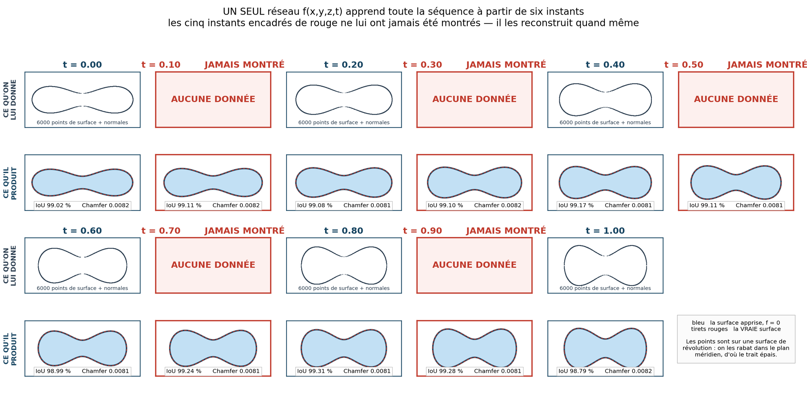
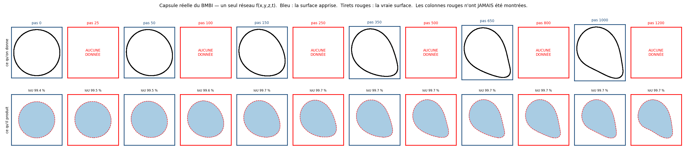

# TZ2 – Méthodes neuronales pour les surfaces implicites

TZ encadrée par Florian De Vuyst (labo BMBI, UTC), faite par Nathan Jacas et Joshua Nancey.

Ce fichier sert de point d'entrée : si tu débarques sur le projet ou que tu veux
juste te repérer, lis-le en premier.

## Le sujet en deux lignes

On veut représenter une surface fermée 3D par une équation implicite f(x,y,z)=0,
mais au lieu de connaître f à l'avance, on l'apprend avec un réseau de neurones à
partir de points (dedans / dehors / sur la surface). Ensuite on reconstruit la
surface avec du marching cubes. Le but final, c'est d'appliquer ça aux capsules
déformables du BMBI, et de « condenser la forme mobile en une surface implicite
espace-temps » — c'est la formulation de la fiche d'enregistrement.

Tout le « pourquoi » et les directions de travail sont dans les mails de Florian
(dossier `Encadrement/`), en particulier celui avec ses recommandations.

## Comment le dossier est rangé

```
TZ2_Surfaces_Implicites_Neuronales/
├── README.md            ce fichier — le point d'entrée
├── Encadrement/         la fiche d'enregistrement de la TZ + les 2 mails de Florian
├── Articles/            la biblio en PDF (DeepSDF, Occupancy Networks, RBC Kuchel)
├── Notebooks/           les notebooks du début, simples à lancer pour visualiser
├── Données/             les capsules du BMBI — CONFIDENTIEL, hors git
├── Presentation/        les slides (soutenance.pdf) et leur source LaTeX
└── Code/                le code sérieux
    ├── README.md          structure des modules et liste des scripts
    ├── PLAN.md            feuille de route et journal d'avancement
    ├── RESULTATS_courbures.md   courbures, invariants, Gauss-Bonnet
    ├── RESULTATS_nuage.md       apprendre depuis un nuage de points seul
    ├── RESULTATS_morphing.md    morphing, booléens, contrôle de la courbure
    ├── RESULTATS_temporel.md    la surface espace-temps (le cœur du sujet)
    ├── RESULTATS_rendu_formes.md  rendu VTK, surfaces complexes, SIREN
    ├── RESULTATS_capsules.md    LES VRAIES DONNÉES DU BMBI
    ├── RESULTATS_capsules_temporel.md  f(x,y,z,t) appris sur la vraie capsule
    ├── src/               les modules (formes, données, réseaux, géométrie, métriques)
    ├── main_*.py          un script par sujet d'étude
    ├── validate_geometry.py     les vérifications des outils géométriques
    └── output/            figures et modèles produits (ignoré par git)
```

- `Encadrement/` — **commence par là** pour comprendre ce qu'on doit faire et dans
  quel esprit. Le mail « recommandations » est le plus important (données
  volumiques, SDF, l'idée du polynôme, le morphing, les surfaces qui évoluent
  dans le temps). La fiche d'enregistrement donne le programme officiel en heures.

- `Articles/` — les deux articles de fond sont DeepSDF (2019) et Occupancy
  Networks (2019) ; l'article Nature Comm 2021 sur le globule rouge donne à la
  fois l'équation quartique de la forme et les formules de courbure qu'on utilise.

- `Notebooks/` — la gyroïde, le globule rouge analytique, et le premier
  apprentissage sur une sphère / un ellipsoïde. Le bon endroit pour se faire la main.

- `Code/` — la version propre et découpée, avec la vraie loss (surface +
  dedans/dehors + eikonal), les métriques, la géométrie différentielle et
  l'ajustement polynomial. Le détail est dans `Code/README.md` et `Code/PLAN.md`.

- `Données/` — le dataset de capsules, reçu le 26/08/2026. **Propriété du
  laboratoire BMBI, transmis sous clause de confidentialité** : le dossier est
  exclu de git et ne doit jamais partir sur un dépôt distant, même privé. Voir
  `Données/README.md` pour le contenu et le mode d'emploi.

- `Presentation/` — les slides de présentation (`soutenance.pdf`, 15 slides dont
  6 d'annexe) et leur source LaTeX.

## Par où commencer (si tu prends le train en route)

1. Lis le mail de recommandations dans `Encadrement/`.
2. Ouvre un notebook dans `Notebooks/` pour voir à quoi ça ressemble.
3. Regarde `Code/README.md`, puis lance `python Code/main_eikonal.py` pour voir
   l'apprentissage « réaliste » tourner (environ 40 secondes).
4. Lance `python Code/validate_geometry.py` : 28 vérifications sur des cas dont
   la réponse est connue d'avance. C'est le meilleur résumé de ce que le code
   sait faire.
5. Si tu ne dois regarder qu'un seul résultat de méthode, c'est
   `Code/RESULTATS_temporel.md` : c'est le cœur du sujet, et la figure y montre
   d'un coup d'œil ce que le réseau a reçu et ce qu'il en a fait.
6. Et pour savoir où on en est vraiment, `Code/RESULTATS_capsules.md` : ce que
   contiennent les vraies données, et en quoi elles remettent en cause deux
   conclusions du travail synthétique.

## Où on en est

**Ce qui marche.** Le pipeline complet points → réseau → marching cubes → figure,
avec une loss réaliste : on n'utilise jamais la valeur exacte de f pour
entraîner, seulement des points de surface, le signe dedans/dehors et la loi
eikonal. Testé sur l'ellipsoïde et le globule rouge, reconstruction sous-voxel.

**Ce qu'on sait mesurer.** Des métriques indépendantes de toute formule (Chamfer,
IoU, Hausdorff, erreur eikonal) — donc transposables aux vraies capsules — et des
invariants géométriques (Euler, aire, volume, Gauss-Bonnet) qui disent si l'on
peut croire une surface reconstruite.

**Le résultat le plus intéressant.** Le Chamfer teste la position de la surface,
l'eikonal teste le gradient ; les courbures testent les dérivées secondes, et
personne ne le fait d'habitude. Verdict : le réseau est juste à l'ordre 2
globalement (Gauss-Bonnet à 0.02 % de 4π) mais il lisse les extrêmes de courbure
d'environ 16 % — au centre du creux du globule il annonce 12.1 au lieu de 14.4.

**Le globule rouge tient en 10 coefficients.** Son équation exacte est une
quartique ; l'ajustement polynomial la retrouve à 5e-7 près, contre 197 886 poids
pour le réseau. C'est l'argument de compression et d'explicabilité que Florian
recommandait.

**La chaîne « données réelles » est prête.** On sait apprendre une surface à
partir d'un simple fichier de nuage de points orienté, sans jamais aucune
formule — c'est ce qui s'appliquera aux capsules du BMBI. Le signe dedans/dehors
déduit du nuage est exact à 100 % dès qu'on s'éloigne un peu de la surface, et
l'entraînement qui s'en sert vaut celui qui triche avec la formule : l'écart
entre les deux est plus petit que la dispersion entre deux graines.

**Le morphing et les opérations booléennes marchent**, sur formules comme sur
champs appris, avec une vérification quantitative (l'identité
`V(A∪B) + V(A∩B) = V(A) + V(B)` tombe à 1.1e-06 % près).

**La surface qui évolue dans le temps — le cœur du sujet.** C'est ce que Florian
appelle « le Graal » et ce que la fiche appelle « condenser la forme mobile en une
surface implicite espace-temps ». Un **seul** réseau `f(x,y,z,t)` apprend toute une
séquence à partir de **six instants écrits sur disque** — le format que rendra le
code Éléments Finis du BMBI. On lui en cache **cinq** :



Aux cinq instants qu'il n'a jamais vus, il reconstruit la surface **aussi bien**
qu'aux instants observés : Chamfer 0.00815 contre 0.00814, IoU 99.10 % contre
99.06 %, topologie correcte partout. Il conserve même un invariant qu'on ne lui a
jamais donné — le volume ne dérive que de **0.041 %** sur toute la séquence. Et on
peut lire sur lui la vitesse de la membrane : un point advecté par `v_n` reste à
0.0003 de la vraie surface après 200 pas d'intégration.

**Mais le contrôle est plus intéressant que le résultat.** Le Chamfer est saturé
par la grille de reconstruction, si bien que sur la seule *position* de la surface,
le réseau fait jeu égal avec un simple morphing entre les deux instants voisins.
Notre déformation est affine, donc trop facile pour cette mesure. Le gain réel est
sur les *dérivées* : sur la vitesse normale, le réseau est **22 fois** plus juste
que le morphing. Ce qu'apporte une surface implicite espace-temps, ce n'est pas de
mieux placer les points — c'est de posséder un champ de vitesse dérivable partout.

**Le rendu et la topologie.** L'affichage PyVista au format VTK est fait, avec
export OBJ / VTK / VTP et série `.pvd` lisible par ParaView — chaque fichier étant
relu et recompté. Et le seul stress-test topologique du projet est passé : sur les
quatre surfaces complexes demandées par la fiche (Chmutov, gyroïde, Barth,
metaballs), **deux ne sont pas fermées**, or tout le pipeline suppose un intérieur
borné. Les metaballs donnent la démonstration la plus directe de l'argument du
sujet : mêmes boules, seuil différent, `χ` passe de 0 à 2.

## Les vraies données sont arrivées (26/08/2026)

Florian a transmis le dataset du BMBI : une capsule déformable dans un canal,
maillage triangulaire de 2562 nœuds matériels, 20001 pas de temps, 1.2 Go.
**Confidentiel — `Données/` est hors git.**

L'analyse est faite (`Code/RESULTATS_capsules.md`) et elle donne trois choses.

**Le maillage entre dans la chaîne sans une retouche.** `χ = 2`, étanche, genre 0,
volume signé positif donc normales déjà sortantes. Deux mois de travail construit
« à l'aveugle » contre ces données tombent sur le bon format.

**La limite n°1 du projet tombe.** On écrivait qu'il fallait durcir le cas
temporel avec une déformation non affine. Les vraies capsules le sont : 14.9 % de
résidu non affine entre snapshots voisins, contre 0 % sur notre séquence
synthétique. Et mieux qu'un pourcentage, une preuve — la capsule part d'une sphère
et **cesse d'être convexe** dès le pas 1500, or l'image affine d'un convexe est
convexe. Le test d'interpolation devient discriminant, et l'étalon morphing part
avec 15 % d'erreur.

**Un de nos contrôles ne se transpose pas, et c'est instructif.** 93 % du
mouvement des nœuds est **tangentiel** : la membrane tourne autour d'une forme qui
bouge peu (tank-treading). On ne peut donc pas valider un suivi lagrangien en
advectant un point par la vitesse normale et en le comparant à la trajectoire d'un
nœud — ce sont deux choses différentes. Ce n'est pas un défaut du champ implicite :
une surface ne porte que son mouvement normal. C'est même un argument pour la
représentation implicite, qui sépare d'office ce qu'un maillage lagrangien confond.

## Et le champ espace-temps tient sur les vraies données

C'est l'objectif de la TZ, et il est atteint : **un seul réseau `f(x,y,z,t)`
appris sur la capsule du BMBI reconstruit les instants qu'on lui a cachés.**
Onze instants observés, dix cachés, rien d'autre. Détail dans
`Code/RESULTATS_capsules_temporel.md`.



**Le réseau bat enfin les méthodes bêtes.** Sur la séquence synthétique, un simple
morphing entre les deux instants voisins faisait jeu égal — parce que notre
déformation était affine. Sur la vraie capsule, qui ne l'est pas, l'écart
apparaît. Et la bonne lecture d'un Chamfer saturé par la grille, c'est l'excédent
sur le plancher de discrétisation :

| aux dix instants jamais vus | Chamfer | excédent sur le plancher | IoU |
|---|---:|---:|---:|
| image gelée | 0.00710 | 53 % du plancher | 97.28 % |
| morphing entre encadrants | 0.00487 | 5.2 % | 99.17 % |
| **réseau `f(x,y,z,t)`** | **0.00464** | **0.16 %** | **99.65 %** |

Aux instants qu'il n'a jamais vus, **le réseau est au plancher de la grille** :
0.004639 contre 0.004634 aux instants observés — les deux sont indiscernables.

**Le résultat le plus utile pour le labo.** À nombre d'instants égal, les
resserrer là où la forme bouge fait passer l'erreur sur la vitesse de la membrane
de 18 % à 4.6 %, et l'excédent de Chamfer d'un facteur 50. Autrement dit :
*le code Éléments Finis doit sauvegarder proportionnellement à la vitesse de
déformation, pas à intervalle constant.* C'est une réponse chiffrée à une question
qui était ouverte.

**Ce qui reste.** La fin de la séquence (pas 4000 à 20000, la relaxation lente),
l'extrapolation au-delà du dernier instant observé, la robustesse au bruit et aux
vues partielles, les familles de formes à code latent. Et la rédaction du rapport,
qui n'est pas commencée — mais les six `RESULTATS_*.md` en sont la matière.
